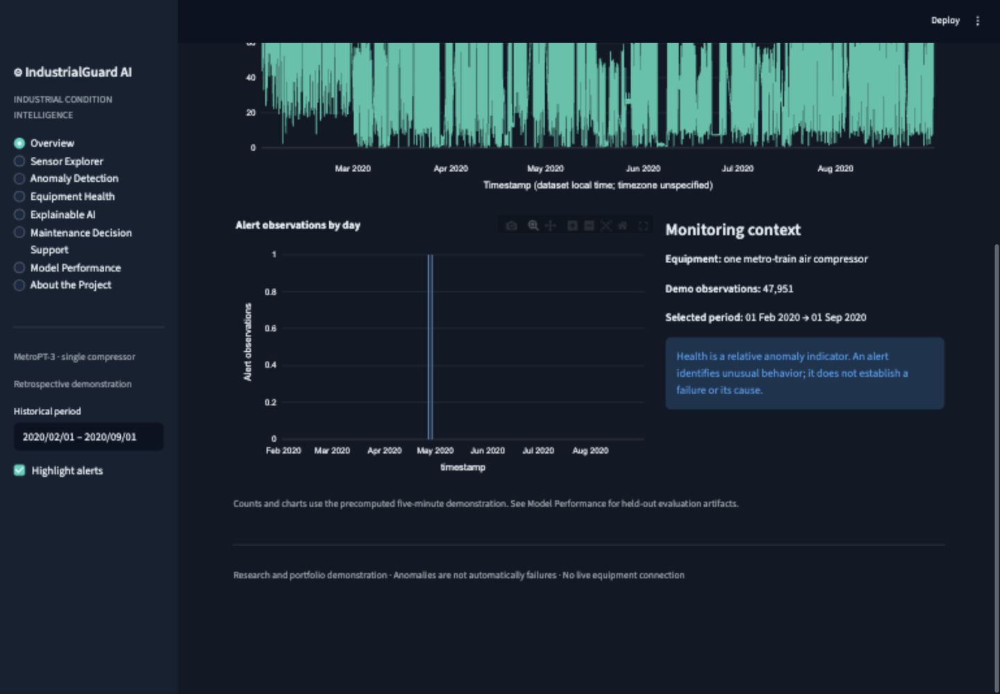
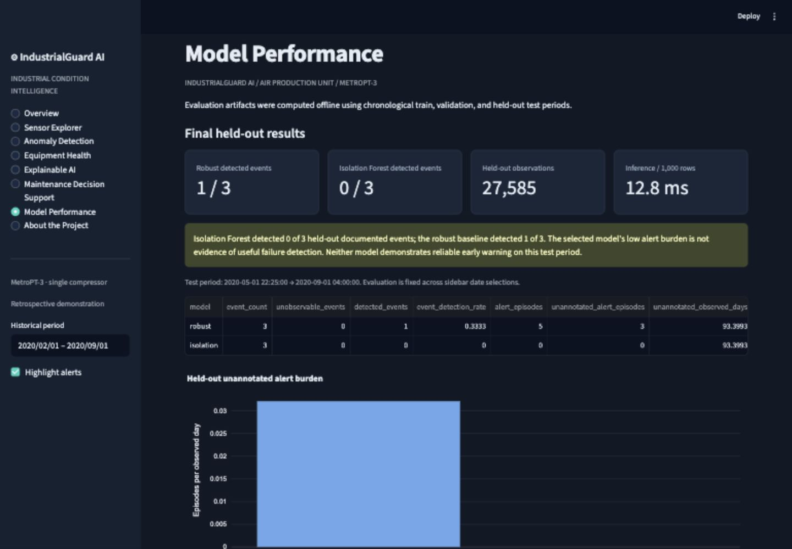

# IndustrialGuard AI

**Explainable Predictive Maintenance & Equipment Health Monitoring Platform**

IndustrialGuard AI turns real metro air-compressor telemetry into an interactive historical condition-monitoring application. It combines causal time-series features, an interpretable statistical baseline, Isolation Forest, chronological evaluation, and transparent explanations. The project demonstrates applied statistics and industrial analytics while keeping the boundary between an anomaly and a documented failure explicit.

[Repository](https://github.com/Enamul22/industrialguard-ai) · [Case study](docs/PORTFOLIO_CASE_STUDY.md) · [Methodology](docs/METHODOLOGY.md) · [Data card](docs/DATA_CARD.md) · [Deployment](docs/DEPLOYMENT.md)

## Industrial problem

Unusual pressure, current, and temperature behavior can guide equipment inspection, but alert volume and legitimate operating changes matter as much as detection. This project asks whether documented historical air leaks overlap issued alerts, which measurements are unusual, and how much unannotated alert burden a maintenance team would encounter. It models one train APU, not an invented fleet. Its skills are transferable to industrial analytics; Metso, Sandvik, John Deere, and Wärtsilä supplied no data and have not validated or deployed the project.

## Capabilities

- Eight application sections: overview, sensor explorer, anomaly detection, equipment health, explainability, maintenance decision support, model performance, and project context.
- Interactive historical sensor and score charts, period filtering, alert episodes, and reported-failure context.
- Validation-relative health and maintenance attention categories, explicitly distinct from failure probability.
- Training-standardized feature deviations for explaining unusual observations without claiming physical causes.
- User-editable illustrative inspection and downtime costs; no claimed observed savings.
- Reproducible official-source ingestion, data-quality checks, EDA figures, saved models, and compact demo artifacts.

## Dataset and attribution

[MetroPT-3, UCI dataset 791](https://archive.ics.uci.edu/dataset/791/metropt+3+dataset) contains 1,516,948 original readings from a metro train's compressor APU in 2020: seven analogue sensors and eight digital channels. Dataset DOI: [10.24432/C5VW3R](https://doi.org/10.24432/C5VW3R). Original data and derived demo measurements retain [CC BY 4.0](https://creativecommons.org/licenses/by/4.0/); code uses MIT.

Attribution: Davari, N., Veloso, B., Ribeiro, R., & Gama, J. (2021). *MetroPT-3 Dataset*. UCI Machine Learning Repository. The demo aggregates and enriches the source readings; raw files remain unchanged locally and are excluded from Git.

The related [2022 Scientific Data paper](https://doi.org/10.1038/s41597-022-01877-3) describes a different 2022 release. Its labels are not imported into the UCI 2020 history. Sampling and maintenance-date discrepancies are investigated in the [data card](docs/DATA_CARD.md).

## Methodology

Five-minute trailing windows feed current and pressure differences plus 15-minute and one-hour rolling summaries. Low-coverage windows and outages reset history. Training precedes March 1; March–April validation sets selection and alert thresholds; May onward is held out. Preprocessing fits training only. April's reported event is excluded from the validation calibration reference, while unannotated observations remain imperfect normal evidence.

The baseline uses the maximum absolute deviation from training medians and interquartile ranges. Isolation Forest compares two subsample sizes using validation-week alert-rate stability. Three consecutive elevated windows issue an alert. Evaluation reports event overlap, descriptive 24-hour preceding warnings, and unannotated alerts per observed telemetry day. The selected forest is not claimed to outperform the baseline on every measure.

## Computed evaluation

The exact reproducible results are saved in [metrics.json](artifacts/metrics.json), with configuration, candidate settings, monthly breakdowns, inference timing, and event records. The [statistical EDA report](reports/EDA.md) contains the source audit, operating summaries and event-aligned figures.

| Frozen policy | Test events detected | Alert episodes | Unannotated episodes | Unannotated alerts / observed day |
|---|---:|---:|---:|---:|
| Robust deviation baseline | 1/3 (33.3%) | 5 | 3 | 0.03212 |
| Isolation Forest (selected on validation) | 0/3 (0%) | 0 | 0 | 0.00000 |

Test observations: **27,585** usable five-minute rows, 2020-05-01 22:25:00–2020-09-01 04:00:00. Non-event observed exposure: **93.399 telemetry days**. Neither method issued a qualifying warning within 24 hours before any final-test event. The baseline detected only the July interval during the reported event. **Earlier failure detection was not demonstrated.**

The forest's zero alerts also mean zero detected events. Its conservative validation-stability selection is a poor failure-sensitive policy in this holdout; quiet operation is not evidence of success. The frozen test is retained without tuning it to improve the displayed results.

Only three final-test intervals are available. Unannotated alerts are not confirmed false alarms, and warning lead times can be coincidental. No narrow generalization confidence intervals, calibrated failure probabilities, or remaining-life predictions are claimed.

## Application preview





The historical demonstration runs locally. A verified public Streamlit deployment URL is not currently recorded.

## Run the committed demonstration

Python 3.11 or newer:

```bash
python -m venv .venv
source .venv/bin/activate
python -m pip install -e '.[dev]'
streamlit run streamlit_app.py
```

Windows: activate `.venv\Scripts\activate`. The app loads precomputed real-data outputs and does not download the original CSV or retrain at startup.

## Reproduce the full workflow

```bash
python scripts/download.py
python scripts/run_pipeline.py
python -m ruff check .
python -m pytest -q
```

The pipeline prepares data, generates causal features, fits and selects candidates, evaluates frozen models, creates EDA and event figures, and exports deployment artifacts. Settings live in `configs/pipeline.json`. Downloading requires internet; fitting is CPU based. Reserve several GB of RAM for the original CSV and intermediate frames. See [deployment instructions](docs/DEPLOYMENT.md) for Streamlit Community Cloud.

## Architecture and stack

```text
app/                    Streamlit presentation
src/industrialguard/    Data, causal features, models, evaluation
configs/                Frozen experiment settings and reported intervals
scripts/                Download and end-to-end reproduction
artifacts/              Persisted model and computed metrics
data/demo/              Compact real historical outputs
data/raw/               Unchanged source files, excluded from Git
reports/                Data audit, EDA, figures and alert episodes
tests/                  Automated analytical and application checks
docs/                   Cards, methodology, case study and deployment
.github/workflows/      Continuous quality checks
streamlit_app.py        Deployment entry point
```

Python, pandas, NumPy, SciPy, scikit-learn, Plotly, Streamlit, PyArrow, Matplotlib, joblib, pytest, and Ruff. Runtime dependencies are version-pinned. GitHub Actions runs lint and tests. [Architecture details](docs/ARCHITECTURE.md).

## Limits and next steps

This is a retrospective portfolio demonstration on one machine. Aggregation hides short transients; operating regimes and seasonality can cause legitimate deviations; reports provide incomplete normal labels; three test events cannot establish general reliability. Explanations are associations and maintenance actions remain human decisions. [Full limitations](docs/LIMITATIONS.md) and [model card](docs/MODEL_CARD.md).

Further work should add expert-reviewed fault and normal labels, prospective multi-machine validation, regime-conditioned models, drift monitoring, and real decision-cost evidence. No industry deployment, production validation, or research novelty is claimed.
