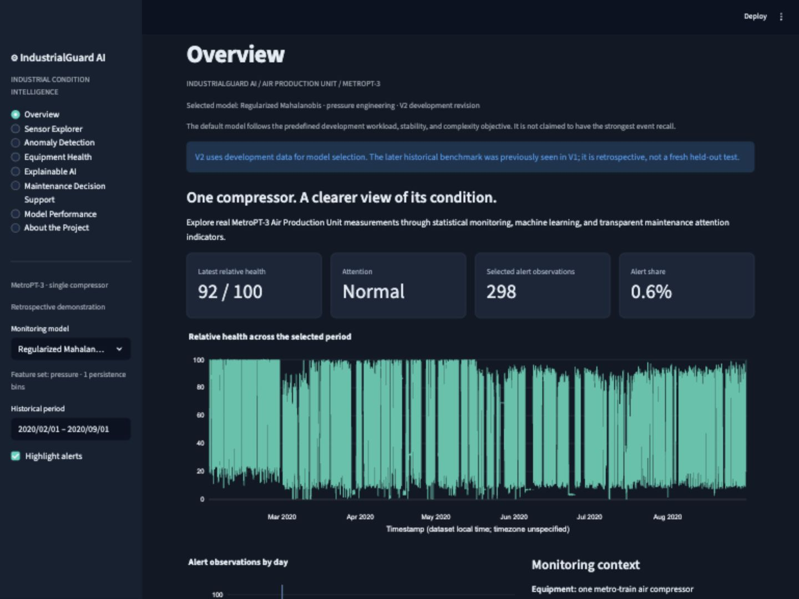
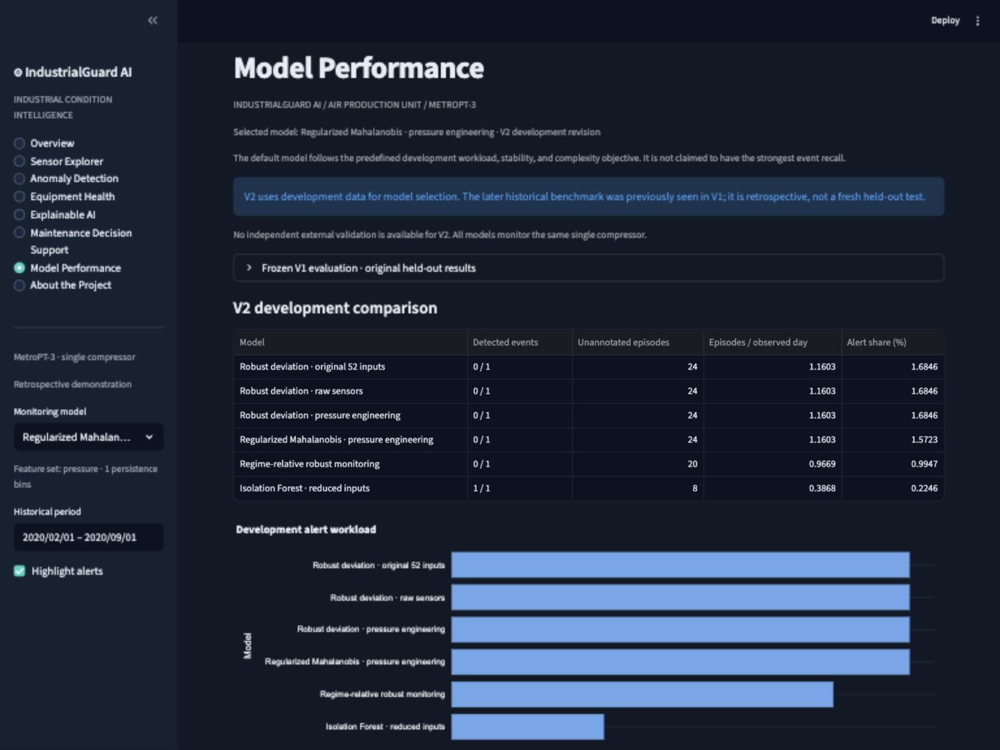

# IndustrialGuard AI

**Explainable Predictive Maintenance & Equipment Health Monitoring Platform**

IndustrialGuard AI turns real metro air-compressor telemetry into an interactive historical condition-monitoring application. Version 2 combines causal engineering features, global and regime-relative statistical monitoring, regularized covariance, Isolation Forest, chronological development experiments and transparent explanations. The project demonstrates applied statistics and industrial analytics while keeping the boundary between an anomaly and a documented failure explicit.

[Repository](https://github.com/Priynka-Roy/industrialguard-explainable-predictive-maintenance) · [Case study](explainable-predictive-maintenance/docs/PORTFOLIO_CASE_STUDY.md) · [Methodology](explainable-predictive-maintenance/docs/METHODOLOGY.md) · [Data card](explainable-predictive-maintenance/docs/DATA_CARD.md) · [Deployment](explainable-predictive-maintenance/docs/DEPLOYMENT.md)

## Industrial problem

Unusual pressure, current, and temperature behavior can guide equipment inspection, but alert volume and legitimate operating changes matter as much as detection. This project asks whether documented historical air leaks overlap issued alerts, which measurements are unusual, and how much unannotated alert burden a maintenance team would encounter. It models one train APU, not an invented fleet. Its skills are transferable to industrial analytics; Metso, Sandvik, John Deere, and Wärtsilä supplied no data and have not validated or deployed the project.

## Capabilities

- Eight application sections: overview, sensor explorer, anomaly detection, equipment health, explainability, maintenance decision support, model performance, and project context.
- Interactive historical sensor and score charts, period filtering, alert episodes, and reported-failure context.
- Calibration-relative health and maintenance attention categories, explicitly distinct from failure probability.
- Training-standardized feature deviations for explaining unusual observations without claiming physical causes.
- User-editable illustrative inspection and downtime costs; no claimed observed savings.
- Reproducible official-source ingestion, data-quality checks, EDA figures, saved models, and compact demo artifacts.

## Dataset and attribution

[MetroPT-3, UCI dataset 791](https://archive.ics.uci.edu/dataset/791/metropt+3+dataset) contains 1,516,948 original readings from a metro train's compressor APU in 2020: seven analogue sensors and eight digital channels. Dataset DOI: [10.24432/C5VW3R](https://doi.org/10.24432/C5VW3R). Original data and derived demo measurements retain [CC BY 4.0](https://creativecommons.org/licenses/by/4.0/); code uses MIT.

Attribution: Davari, N., Veloso, B., Ribeiro, R., & Gama, J. (2021). *MetroPT-3 Dataset*. UCI Machine Learning Repository. The demo aggregates and enriches the source readings; raw files remain unchanged locally and are excluded from Git.

The related [2022 Scientific Data paper](https://doi.org/10.1038/s41597-022-01877-3) describes a different 2022 release. Its labels are not imported into the UCI 2020 history. Sampling and maintenance-date discrepancies are investigated in the [data card](explainable-predictive-maintenance/docs/DATA_CARD.md).

## Version 2 methodology and evidence

February supplies training; March supplies calibration; April supplies primary development. An earlier March development fold assesses workload stability. Training-only fits, causal gap-reset features and calibration-only thresholds precede development-only model/policy selection. The frozen candidate grid compares original, raw, pressure-engineered and reduced representations, with global robust, regularized covariance, regime-relative robust and Isolation Forest methods. Quantiles 0.98/0.995 and persistence 1/3 bins expose sensitivity/workload trade-offs.

Selection uses a predeclared workload objective, burden limits, anti-silence eligibility and a secondary credit for the single April event. That event cannot establish generalization. May–September was already inspected in V1 and is a **retrospective benchmark**, not a fresh holdout. No external independent validation is available. [Protocol](explainable-predictive-maintenance/docs/V2_METHODOLOGY.md) · [Experiments](explainable-predictive-maintenance/docs/V2_EXPERIMENTS.md) · [Computed V2 results](explainable-predictive-maintenance/docs/V2_RESULTS.md) · [Metric definitions](explainable-predictive-maintenance/docs/EVALUATION_DEFINITIONS.md) · [Technical audit](explainable-predictive-maintenance/docs/V2_TECHNICAL_AUDIT.md).

The selected V2 covariance policy detects **0/1 April development events and 1/3 retrospective events**, with **15 unannotated retrospective episodes (0.16060/day)**. Reduced Isolation Forest detects **2/3 retrospectively**, with 22 unannotated episodes, but is not chosen by the predefined workload objective. The covariance policy’s July warning is 40 minutes before the reported onset; this remains retrospective evidence. Reliable earlier failure detection is not established.

## Preserved Version 1 results

| Frozen historical policy | Original test events detected | Unannotated episodes | Episodes per unannotated observed day |
|---|---:|---:|---:|
| Robust deviation | 1/3 | 3 | 0.03212 |
| Isolation Forest | 0/3 | 0 | 0.00000 |

Neither V1 method demonstrated a qualifying warning in the preceding 24 hours. The original metrics remain unchanged; [V1 baseline](explainable-predictive-maintenance/docs/V1_BASELINE.md), `docs/v1/`, `artifacts/v1/` and tag `v1.0.0` preserve historical methods and results. V2 evaluation fixes are separately labeled. Unannotated alerts are not confirmed false alarms; scores and relative health are not failure probabilities or remaining life.

## Application preview





**[Open the local app in your browser](http://localhost:8501)**

Start the app using the instructions below before clicking this link. `localhost` refers to the reader’s own computer; it is not a public hosted demo.

## Run the committed demonstration

Python 3.11 or newer, from the Git repository root:

```bash
python -m venv .venv
source .venv/bin/activate
python -m pip install -e './explainable-predictive-maintenance[dev]'
streamlit run explainable-predictive-maintenance/streamlit_app.py
```

After starting Streamlit, open **[http://localhost:8501](http://localhost:8501)** in your browser.

Windows: activate `.venv\Scripts\activate`. The app loads precomputed real-data outputs and does not download the original CSV or retrain at startup.

## Reproduce the full workflow

```bash
python explainable-predictive-maintenance/scripts/download.py
python explainable-predictive-maintenance/scripts/run_v2.py
python -m ruff check explainable-predictive-maintenance
python -m pytest explainable-predictive-maintenance/tests -q
```

The pipeline prepares data, generates causal features, fits and selects candidates, evaluates frozen models, creates EDA and event figures, and exports deployment artifacts. V2 settings live in `configs/v2.json`; separate V2 outputs preserve V1 artifacts. Reproduce historical V1 only in a disposable checkout of `v1.0.0`. Downloading requires internet; fitting is CPU based. Reserve several GB of RAM for the original CSV and intermediate frames. See [deployment instructions](explainable-predictive-maintenance/docs/DEPLOYMENT.md) for Streamlit Community Cloud.

## Architecture and stack

The project files below live in `explainable-predictive-maintenance/`; GitHub Actions and runtime configuration remain at the Git root.

```text
app/                    Streamlit presentation
src/industrialguard/    Data, causal features, models, evaluation
configs/                Frozen experiment settings and reported intervals
scripts/                Download and end-to-end reproduction
artifacts/              Persisted model and computed metrics
data/demo/              Compact real historical outputs
data/raw/               Unchanged source files, excluded from Git
reports/                Data audit, EDA, figures and alert episodes
tests/                  Automated analytical and application checks
docs/                   Cards, methodology, case study and deployment
streamlit_app.py        Deployment entry point
```

Python, pandas, NumPy, SciPy, scikit-learn, Plotly, Streamlit, PyArrow, Matplotlib, joblib, pytest, and Ruff. Runtime dependencies are version-pinned. GitHub Actions runs lint and tests. [Architecture details](explainable-predictive-maintenance/docs/ARCHITECTURE.md).

## Limits and next steps

This is a retrospective portfolio demonstration on one machine. Aggregation hides short transients; operating regimes and seasonality can cause legitimate deviations; reports provide incomplete normal labels; three previously inspected benchmark events cannot establish general reliability. Explanations are associations and maintenance actions remain human decisions. [Full limitations](explainable-predictive-maintenance/docs/LIMITATIONS.md) and [model card](explainable-predictive-maintenance/docs/MODEL_CARD.md).

Further work should add expert-reviewed fault and normal labels, prospective multi-machine validation, verified operating-state labels, drift monitoring, and real decision-cost evidence. No industry deployment, production validation, or research novelty is claimed.
